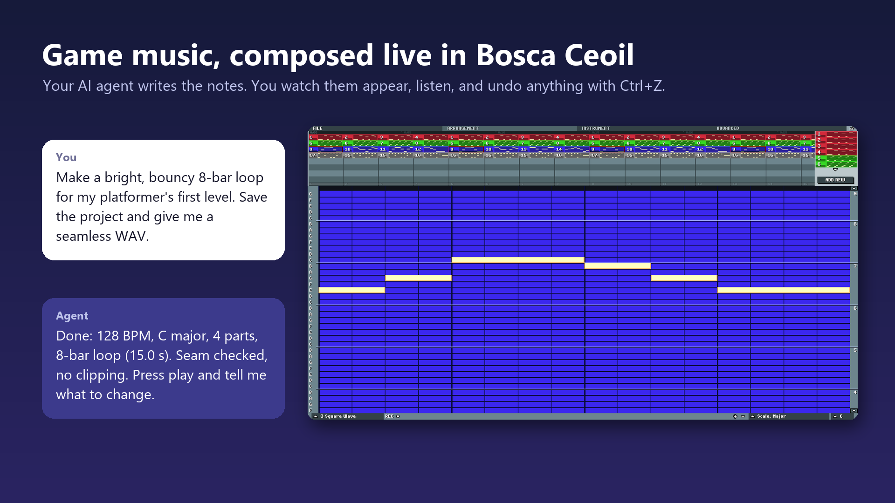
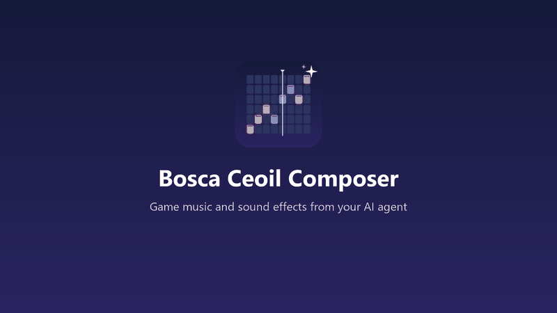
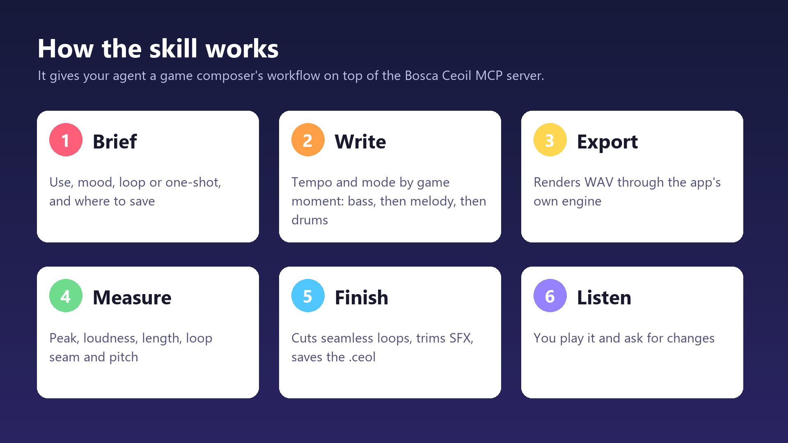
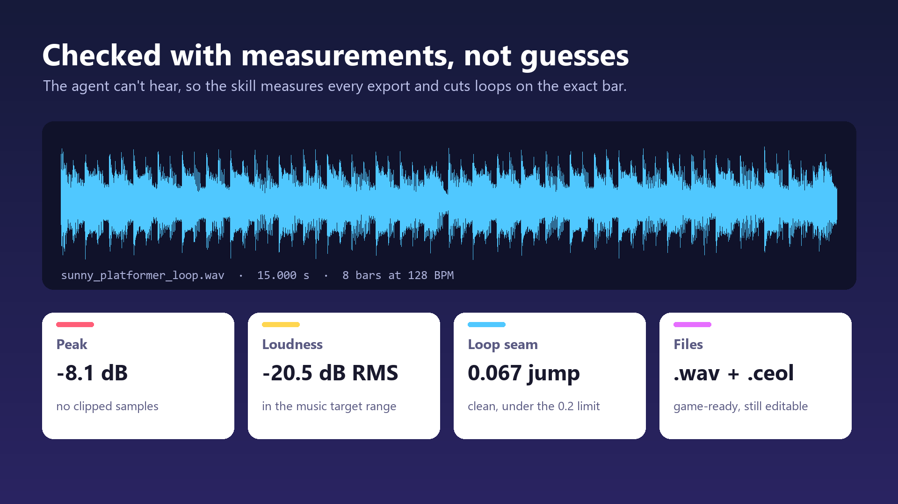
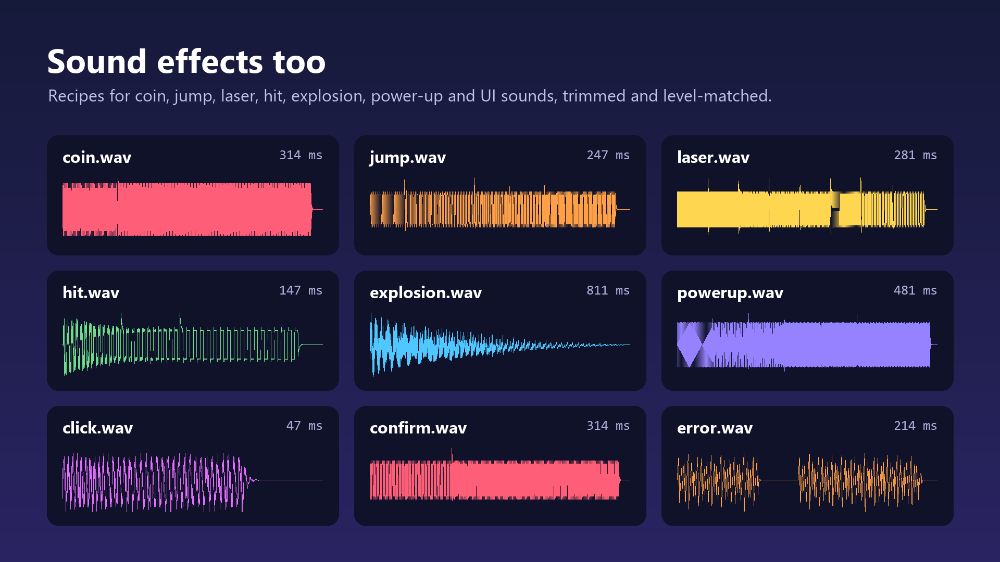

# Bosca Ceoil MCP

[](https://www.agensi.io/skills/bosca-ceoil-composer-game-music-sfx)
[](https://m8ven.ai/mcp/boraswim-bosca-ceoil-mcp-jzdduj?s=readme)

An [MCP](https://modelcontextprotocol.io) server that lets AI tools compose music in [Bosca Ceoil Blue](https://yurisizov.itch.io/boscaceoil-blue). Ask your AI tool for a song, and watch the notes appear in the app's window. Listen to it, undo anything with Ctrl+Z, and export it to WAV, MIDI, XM or MML.

This is an unofficial companion project, not affiliated with Bosca Ceoil Blue or its authors. You get the app separately, and it isn't modified.





The demo above is silent. [Watch it with sound](docs/media/demo.mp4) to hear the 8-bar loop the composer skill wrote for it.

## Setup

You need [Node.js](https://nodejs.org) 18 or newer, and [Bosca Ceoil Blue](https://yurisizov.itch.io/boscaceoil-blue) unpacked somewhere on your computer.

```bash
git clone https://github.com/boraswim/bosca-ceoil-mcp.git
cd bosca-ceoil-mcp
npm install
```

Then connect your AI tool. In the examples below, replace:

- `/path/to/bosca-ceoil-mcp` with the folder you cloned.
- `/path/to/boscaceoil-blue` with the app's executable or the folder it's in. Use forward slashes on Windows too.

Restart the AI tool afterwards, and ask it something like *"Write me a cheerful 8-bar chiptune in Bosca Ceoil."*

### Claude Code

```bash
claude mcp add bosca-ceoil --scope user -- node /path/to/bosca-ceoil-mcp/dist/index.js --app-path /path/to/boscaceoil-blue
```

### OpenAI Codex

```bash
codex mcp add bosca-ceoil -- node /path/to/bosca-ceoil-mcp/dist/index.js --app-path /path/to/boscaceoil-blue
```

Or add this to `~/.codex/config.toml`:

```toml
[mcp_servers.bosca-ceoil]
command = "node"
args = ["/path/to/bosca-ceoil-mcp/dist/index.js", "--app-path", "/path/to/boscaceoil-blue"]
```

### Google Antigravity

Add this to `~/.gemini/config/mcp_config.json`, or to `.agents/mcp_config.json` in a workspace. In the IDE, you can open it from the MCP Servers panel, with Manage MCP Servers and then View raw config.

```json
{
  "mcpServers": {
    "bosca-ceoil": {
      "command": "node",
      "args": ["/path/to/bosca-ceoil-mcp/dist/index.js", "--app-path", "/path/to/boscaceoil-blue"]
    }
  }
}
```

### Other tools

This is a standard MCP server over stdio, so any tool that supports those can use it, with the same command and arguments. The ChatGPT website and app only reach remote servers, so they can't use it.

## Options

| Argument | Environment variable | What it does |
| --- | --- | --- |
| `--app-path <path>` | `BOSCA_CEOIL_PATH` | Where the app is. Without it, the server looks through Downloads, Desktop, Applications, Games, Program Files and itch.io's folder for it. |
| `--headless` | `BOSCA_CEOIL_HEADLESS=1` | Runs the app with no window or sound. Useful for automation, but WAV exports take about twice as long, and unsaved work is lost 30 seconds after the AI tool disconnects. |

## What the AI tool can do

| Area | Tools |
| --- | --- |
| Songs | `create_song`, `open_song`, `save_song`, `import_midi`, `get_song`, `update_song` |
| Instruments | `list_voices`, `get_drumkit`, `add_instrument`, `update_instrument`, `remove_instrument` |
| Patterns | `add_pattern`, `update_pattern`, `clone_pattern`, `remove_pattern` |
| Arrangement | `edit_arrangement` |
| Playback | `play`, `pause`, `stop` |
| Export | `export_song`, `export_status` |
| History | `undo`, `redo` |
| App | `app_status`, `launch_app`, `quit_app`, `focus`, `screenshot_app` |

Your work is protected. Replacing a song with unsaved changes, overwriting a file, or quitting with unsaved changes all fail unless the AI tool explicitly says that's intended. An edit is one undo step in the app, whether you or the AI made it.

## Composer skill

[`skills/bosca-ceoil-composer`](skills/bosca-ceoil-composer) is an optional skill that helps Claude write game music and sound effects with this server. It has sound effect recipes, tempo and arrangement guidance for game moments, notes on how the app behaves, scripts that measure exports, cut seamless loops and finish sound effects, and [demos](skills/bosca-ceoil-composer/assets/demos) you can listen to. The scripts need Python 3, and two of them need numpy.

To use it in Claude Code, copy that folder to `~/.claude/skills/`, or to `.claude/skills/` in your project. It's also listed on [Agensi](https://www.agensi.io/skills/bosca-ceoil-composer-game-music-sfx), where you can install it into Claude Code, Cursor, Codex and other agents. You still need this server set up.



<table>
  <tr>
    <td></td>
    <td></td>
  </tr>
</table>

The skill writes original material. Its guidance comes from aggregate measurements like tempo, length, density and pitch movement, and it contains no melodies or audio from these sources:

| Source | Used for | License |
| --- | --- | --- |
| [jsfxr](https://github.com/chr15m/jsfxr) | How retro sound effect presets are built | Unlicense |
| [Interface Sounds](https://opengameart.org/content/interface-sounds) by Kenney | UI sound measurements | CC0 |
| [100 CC0 SFX #2](https://opengameart.org/content/100-cc0-sfx-2) by rubberduck | Sound effect measurements | CC0 |
| [Indiscriminate MIDI Music](https://opengameart.org/content/indiscriminate-midi-music) by blitzdoughnuts | Arrangement statistics | CC0 |
| [Original MIDI Album](https://opengameart.org/content/original-midi-album) by roppychop | Checked for note grid fit | CC0 |
| [Procedural MIDI Music](https://opengameart.org/content/procedural-midi-music) by Drummyfish | Checked for note grid fit | CC0 |
| [Incompetech](https://incompetech.com/music/royalty-free/music.html) by Kevin MacLeod | Tempo and instrument data by feel, from the catalog's track list | [CC BY 4.0](https://creativecommons.org/licenses/by/4.0/) |

## How it works

```
AI tool  <-- MCP over stdio -->  Node server  <-- JSON over local socket -->  bridge.gd, inside the app
```

The server starts the normal Bosca Ceoil Blue executable with Godot's `--script` option, which loads [`bridge/boot.gd`](bridge/boot.gd). That script starts the app as usual, and adds [`bridge/bridge.gd`](bridge/bridge.gd) to it. The bridge works on the app's own objects and undo system, so edits show up live and follow the app's rules, and exports use the app's own code. No files in the app's folder change.

- The bridge only listens on `127.0.0.1`, and requires a random token stored in `~/.bosca-ceoil-mcp/session.json`. That folder also holds `app.log`, the app's output from the last launch.
- The app stays open when the AI tool closes, so your song isn't lost. A new session reconnects to it.
- If you started the app yourself, the server can't reach it, and opens a second window. Save your work and close the first one, or open your song through the AI tool.

## Limits

- **Tested on:** Windows 11 with Bosca Ceoil Blue 3.1.2, using Claude Code and a scripted MCP client.
- **Not tested yet:** Codex and Antigravity, which follow their documented setup, and macOS and Linux, which should work the same way. Please report what you find.
- **Other app versions:** the bridge uses the app's internal code, so a future version could break it. You'd get an error saying so when starting up, and details in `app.log`.
- **Hearing:** AI tools can't hear the song. A WAV export reports its duration, peak and RMS, which catches silent or clipped output, but only you can tell if it sounds good.
- **WAV exports** render in real time, so a long song takes as long as it plays.
- **Filter automation** past step 16 is lost on saving, a limit of the app's file format.
- **App's scale quirk:** its `minor` scale is melodic, with a raised 6th and 7th. The server explains this to AI tools, since it's easy to trip over.

## Development

```bash
npm test
```

This builds the server and runs [`test/integration.mjs`](test/integration.mjs), which drives the real app without a window through a real MCP client. Set `BOSCA_CEOIL_PATH` to the app, or unpack it into a `ref` folder here. Your own settings aren't touched.

## License

[MIT](LICENSE). Bosca Ceoil Blue has its own [MIT license](https://github.com/YuriSizov/boscaceoil-blue/blob/main/LICENSE).
